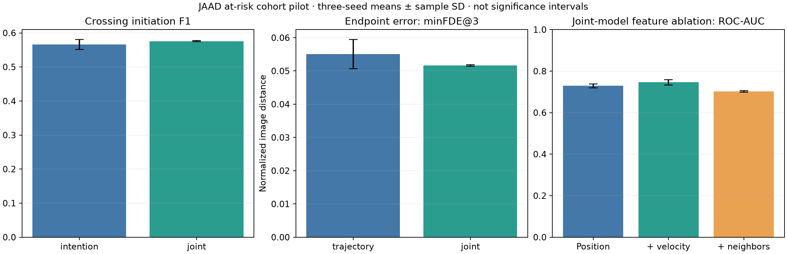

# CrossMind AI: a reproducible joint-prediction pilot

## Abstract

We implement and run a pedestrian crossing-initiation and trajectory prediction
pipeline on JAAD annotations. A small shared GRU is compared with independently
trained task encoders over three seeds. The selected cohort contains 703 training,
149 validation and 562 test windows. Joint training yields mixed changes: slightly
higher F1 and lower endpoint error, essentially unchanged ROC-AUC/minADE, and
worse average precision. Feature ablations show that the present neighbor features
can hurt intention prediction. These preliminary observations do not establish
statistical significance or novelty. A real video demonstration verifies detector,
tracker, pose overlay and checkpoint-backed inference integration.

## Introduction

Crossing initiation is a future event distinct from current crossing state.
Trajectory prediction is uncertain because several movements may be plausible.
This project investigates whether sharing a temporal encoder helps these tasks.
It prioritizes a reproducible, auditable pilot over a claim of deployment readiness.

## Related work

PIE [1] studies intention and trajectory prediction in driving footage. BiPed [2]
already jointly predicts pedestrian actions and trajectories; shared task heads
are therefore not a new contribution. Social-LSTM [3] motivates interaction-aware
models. Ego-vehicle trajectory research [4] highlights why image motion is not
equivalent to pedestrian motion in world coordinates. JAAD [5] supplies the
annotations used here. This pilot is not a reproduction of these papers' protocols.

## Problem formulation

Given 1 second of observations, predict a binary crossing transition in the next
2 seconds, conditional on not crossing at the observation endpoint, and 20 future
positions sampled at 10 Hz. Complete dense crossing annotation is required through
the horizon; censored and currently crossing windows are excluded. Positions are
normalized bounding-box bottom centers. See DATA_CARD.md for exact eligibility.

## Method

The 48-dimensional GRU encodes nine features: absolute xy, endpoint-relative xy,
velocity xy, mean observed-neighbor offset xy and neighbor count. Feature means
and scales are fitted only on training windows. The binary head uses cross entropy.
The trajectory head produces three complete-path Gaussian components with
diagonal per-coordinate conditional scales and mixture logits. Its exact
whole-trajectory negative log-likelihood uses log-sum-exp across modes. The joint
loss sums classification loss and trajectory NLL divided by twice the future
length. No ground-truth future intent is fed into the trajectory head.

The components can have jagged mean paths; no smoothness or collision constraint
is imposed. Scores are not calibrated. Pose skeletons come from pretrained
YOLO11n-pose but are display-only. ByteTrack supplies temporary video track IDs;
these do not identify real people.

## Experimental setup

Official JAAD default clip lists: 177 train, 29 validation, 117 test clips. The
at-risk eligible windows contain 295/47/201 positives respectively. Complete
window selection is shared by all models and baselines. These are clip-disjoint
splits; geographic/source-route independence has not been verified.

Seeds: 17, 29, 43. AdamW, learning rate 0.003, weight decay 0.0001, batch 32,
gradient clipping 5, at most 30 epochs, validation early stopping patience 8,
ReduceLROnPlateau scheduling. Natural class prevalence is preserved. Decision
threshold is fixed at 0.5. Checkpoint selection uses validation loss only.
CPU PyTorch 2.15.0, Python 3.13.9. Exact environment is in requirements-lock.txt.
Source/data/checkpoint hashes and histories accompany each run.

## Results

Mean ± sample standard deviation over three seeds. All displacement values are
normalized-image Euclidean distances, not meters. These scores cannot be directly
compared to published JAAD action-classification or bounding-box protocols.

| Model | F1 | ROC-AUC | Brier ↓ | minADE@3 ↓ | minFDE@3 ↓ |
|---|---:|---:|---:|---:|---:|
| Intention only | 0.5660 ± 0.0147 | 0.7033 ± 0.0030 | 0.2219 ± 0.0048 | — | — |
| Trajectory only | — | — | — | 0.02482 ± 0.00118 | 0.05509 ± 0.00437 |
| Joint | 0.5758 ± 0.0018 | 0.7028 ± 0.0036 | 0.2183 ± 0.0024 | 0.02481 ± 0.00008 | 0.05166 ± 0.00023 |

Average precision drops from 0.5735 (intention only) to 0.5609 (joint). ECE drops
from 0.1310 to 0.1159, but remains substantial. No calibration procedure has been
applied. The training-prevalence predictor has Brier 0.2336 and ROC-AUC 0.5.

The stationary baseline has ADE/FDE 0.06382/0.12918. Constant velocity has
0.04817/0.11270. Learned highest-score-mode ADE/FDE are 0.04038/0.09693 for
trajectory-only and 0.04129/0.09671 for joint. These K=1 designated-mode scores
are the appropriate deterministic comparison; best-of-three enjoys an oracle
selection advantage. Endpoint miss threshold is 0.1 normalized-image units.
NLL is reported in run JSON; negative values are valid density NLL in these units.

## Ablation studies

Same joint architecture, windows and seeds; unused channels are zeroed and their
normalization fitted on training data. Reported values are three-seed means.

| Features | F1 | ROC-AUC | Brier ↓ | minADE@3 ↓ | minFDE@3 ↓ |
|---|---:|---:|---:|---:|---:|
| Position history | 0.5690 | 0.7287 | 0.2026 | 0.02625 | 0.05620 |
| Position + velocity | 0.5899 | 0.7460 | 0.2014 | 0.02435 | 0.05257 |
| Position + velocity + neighbors | 0.5758 | 0.7028 | 0.2183 | 0.02481 | 0.05166 |

Adding the present pooled neighbor features worsens ROC-AUC/Brier versus position
and velocity, despite slightly lower best-mode endpoint error. Possible causes
include image-space geometry, ego-motion and coarse neighbor aggregation; these
are hypotheses, not established explanations. Per-run results retain variation.
Pose and scene ablations have not been run.

## Video integration and verification

An attributed 150-frame JAAD clip was processed with YOLO11n-pose, ByteTrack and
the seed-17 joint checkpoint. Three distinct IDs and 173 predictions with three
modes each were recorded. Measured processing throughput was 8.23 FPS on CPU.
At 640 input size the initial test missed these small pedestrians; 1280 was used
for the verified demo. Several visible people are still missed; tracking accuracy
and identity-switch rates have not been quantified. The footage illustrates
integration, not calibrated intent recognition or all-person recall.

The video and overlay are generated locally using the README commands; footage is not redistributed in this repository.

Thirty-eight tests passed in the 2026-11-22 audit, including native-coordinate parsing, missing labels,
timestamp gaps, split overlap, analytic Gaussian NLL, head gradients, exact
checkpoint resumption, and application rendering. The browser layout was inspected.

## Discussion and limitations

The hypothesis receives mixed preliminary support, not a conclusive positive
result. Only three seeds and one dataset/task definition are studied. Windows
overlap, so standard deviation across seeds is not a population confidence
interval. Group-bootstrap significance testing is outstanding. Eligibility
favors long, visible non-crossing prefixes. Class balance and losses differ from
published benchmarks. Separate models stop on their own task loss; the joint
model stops on combined validation loss. No extensive tuning or capacity-matched
budget study was performed.

No current crossing-state classifier, scene segmentation, vehicle features,
pose-based prediction, time-to-crossing head or calibrated trajectory coverage
is implemented. The live model receives detector tracks while training used
annotations. The UI displays onset scores conditionally and marks current state
unavailable. Mode trajectories can be implausible; they have no physical guarantee.
GPU operation, longer horizons, scene generalization and occlusion robustness
remain to be studied. A full paper or safety-critical deployment claim is premature.

## Conclusion

A functioning and measured research pilot now exists, with real training,
independent/joint comparisons, feature ablations and video inference. Its next
scientific priorities are stronger data protocols, calibration and interaction
modeling, guided by the negative as well as positive observed results.

## References

1. Rasouli et al., PIE, ICCV 2019: https://openaccess.thecvf.com/content_ICCV_2019/papers/Rasouli_PIE_A_Large-Scale_Dataset_and_Models_for_Pedestrian_Intention_Estimation_ICCV_2019_paper.pdf
2. Rasouli et al., Bifold and Semantic Reasoning for Pedestrian Behavior Prediction, ICCV 2021: https://arxiv.org/abs/2012.03298
3. Alahi et al., Social LSTM, CVPR 2016: https://openaccess.thecvf.com/content_cvpr_2016/html/Alahi_Social_LSTM_Human_CVPR_2016_paper.html
4. Neumann and Vedaldi, Pedestrian and Ego-Vehicle Trajectory Prediction From Monocular Camera, CVPR 2021: https://openaccess.thecvf.com/content/CVPR2021/html/Neumann_Pedestrian_and_Ego-Vehicle_Trajectory_Prediction_From_Monocular_Camera_CVPR_2021_paper.html
5. Rasouli, Kotseruba and Tsotsos, Are They Going to Cross?, ICCVW 2017; dataset: https://github.com/ykotseruba/JAAD
